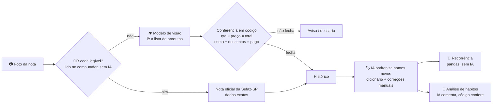

# Assistente de compras com IA

**Uma foto da notinha do mercado vira histórico de gastos, previsão do que está acabando e uma análise dos hábitos de compra de acordo com uma meta (economizar, comer melhor, ganhar massa, emagrecer).**

🔗 **Demo ao vivo:** [assistente-compras-ai.streamlit.app](https://assistente-compras-ai.streamlit.app/) · Projeto irmão: [Central de operações de reviews com IA](https://central-reviews-ai.streamlit.app/)

---

## O problema

Quase ninguém sabe quanto gasta no mercado, com o quê, nem de quanto em quanto tempo compra cada coisa. A informação existe, e está em cada nota fiscal (NFC-e), mas presa em papel térmico que apaga, com nomes como `OVO BCO EXT YAN`, `LTE COND SEMIDESN IT` e `#1700900#18069000#TRUFA CHOC 30`.

Para virar decisão ("ovo acaba a cada ~20 dias", "higiene é 30% do meu gasto"), a nota precisa passar por três problemas difíceis:

1. **Entrada**: tirar os dados do papel sem que a pessoa digite nada;
2. **Padronização**: entender que `OVO BCO EXT YAN` e `OVOS BRANCOS 12UN` são o mesmo produto;
3. **Confiança**: um número errado no histórico estraga todas as análises de depois.

## A solução



| Peça | O que faz |
|---|---|
| **Leitor de QR em 3 motores** ([`qrcode.py`](src/mercado/qrcode.py)) | O QR da NFC-e é denso e o papel vem amassado. Tenta WeChat/OpenCV, OpenCV e ZXing em recortes, ampliações e binarização. O link do QR abre a nota **oficial** da Sefaz-SP sem captcha: dados exatos e de graça. |
| **Leitura por foto** ([`ler_foto.py`](src/mercado/ler_foto.py)) | Plano B quando não há QR legível: modelo de visão (Gemini) devolve JSON validado (Pydantic). A matemática é **conferida em código**; nota que não fecha não entra calada no histórico. |
| **Padronização de produtos** ([`padronizar.py`](src/mercado/padronizar.py)) | LLM transforma nomes abreviados em produto genérico + categoria (`LTE COND SEMIDESN IT` → leite condensado, mercearia). Nome já visto vem de um dicionário (sem nova chamada); **correção manual sempre ganha do modelo**. |
| **Recorrência** ([`recorrencia.py`](src/mercado/recorrencia.py)) | Intervalo médio entre compras de cada produto → "deve acabar em X" → lista de compras sugerida. Só cálculo, sem IA. |
| **Despensa e lista** ([`despensa.py`](src/mercado/despensa.py)) | Última compra sempre à mão; "preciso comprar ovo?" responde com a última compra, a quantidade e quanto o item costuma durar; lista de compras em checklist montada sozinha. A pessoa responde "acabou" / "ainda tenho" e isso vira dado: a próxima estimativa usa o consumo real dela. Sem IA: custo zero e resposta explicável. |
| **Análise de hábitos** ([`habitos.py`](src/mercado/habitos.py)) | O código resume o histórico; a IA recebe **só o resumo agregado** e a meta, e devolve diagnóstico + sugestões. O código descarta sugestão que aponte algo que não existe no histórico ou prometa economizar mais do que se gasta. |
| **App** ([`app/app.py`](app/app.py)) | Streamlit: adicionar nota (câmera ou upload), histórico, "o que está acabando" e análise com IA. Na demo pública, nada é salvo e a leitura por foto é limitada por sessão. |

## O resultado

### Leitura por foto: 40 de 51 notas com a conta fechando (78%)

51 fotos de cupons do dataset público [*Set of images with text in Portuguese for OCR*](https://www.kaggle.com/datasets/sc0v1n0/electronic-tax-document) (Kaggle, licença CC0), lidas pelo `gemini-3.5-flash-lite`. Não há gabarito, então a métrica é a **própria matemática da nota**: cada item (qtd × preço = total) e a nota inteira (soma − descontos = valor pago).

| Modelo | Conta fecha | Tempo por foto | Custo |
|---|---|---|---|
| `gemini-3.5-flash-lite` (API) | **40/51 (78%)** | ~4 s | US$ 0 (plano gratuito) |
| `qwen2.5vl:7b` (local, Ollama) | 1/3 | ~10 min | US$ 0 |

- As 11 que não fecharam são quase todas **cupons longos (39 a 51 itens)** em que o modelo pulou linhas. A conferência pegou todas e elas ficaram fora do histórico, em vez de entrar com dados faltando.
- O modelo local foi testado porque mantém a foto no computador; na prática ficou lento demais e errou a soma em 2 de 3 notas. Ficou como alternativa no `.env`, não como padrão.

### Padronização de nomes

| Modelo | Nomes corretos (conferência manual de uma amostra) |
|---|---|
| `qwen2.5:7b` (local) | ~64% |
| `gemini-3.5-flash-lite` | ~90% |

O restante é coberto por 16 **correções manuais** (`data/correcoes_produtos.csv`), que viraram regras no prompt ("QUILO" = comida por quilo, "OVO PASCOA" ≠ ovo de galinha).

### Histórico real

25 notas da autora (fev–nov/2026, R$ 1.952,46, 73 produtos) + 34 notas de alimentos do dataset do Kaggle (as 6 só de farmácia ficaram de fora), usadas para dar volume aos gráficos. No app, uma chave liga e desliga essas notas; a **análise de hábitos usa só as notas da autora**, porque hábito é de uma pessoa.

### Perfil sintético de longo prazo

Com 25 notas em poucos meses, recorrência e lista de compras ficam pobres. Para mostrar o app funcionando com
um histórico longo, o app abre num **perfil sintético**: 200 idas ao mercado entre 01/2025 e 11/2026, montadas
([`sintetico.py`](src/mercado/sintetico.py)) a partir de cestas reais do dataset público
[*Groceries dataset*](https://www.kaggle.com/datasets/heeraldedhia/groceries-dataset) (Kaggle, GPL 2).

- O dataset original não serve direto: 3.898 clientes com no máximo 11 compras cada em 2 anos, sem preço.
  Aqui, cada ida junta 3 cestas reais (~7 itens), ganha uma data aleatória (~2 idas por semana) e cada
  produto ganha nome em português, categoria e preço típico em R$ ([tabela](demo/sintetico/traducao_groceries.csv)).
- **Datas, preços e a "pessoa" são inventados** (semente fixa, reproduzível); o app sempre identifica o perfil
  como sintético e nunca o mistura com o histórico real. Os dados derivados seguem a licença GPL 2 do original.
- Resultado: R$ ~640/mês, 131 produtos, recorrências como legumes a cada ~9 dias e leite a cada ~9 dias.

### Análise de hábitos (meta "economizar", base da demo)

> Higiene é 29,5% do gasto (R$ 576,95) → trocar marcas de itens como sabonete líquido: ~R$ 24,72/mês. Doces e snacks (10,9%) → planejar compras sazonais como ovo de páscoa: ~R$ 9,09/mês.

As estimativas vêm da IA, mas o código só aceita a sugestão se ela citar uma categoria ou produto do histórico e não prometer economizar mais do que o gasto mensal daquilo.

## Privacidade (decisões de projeto)

Notas fiscais carregam mais do que parece. O que foi feito:

| Risco | Tratamento |
|---|---|
| **Qual mercado a pessoa frequenta** | CNPJ e nome viram apelido (`loja_A`, `loja_B`) com de-para só local. Nomes brutos também entregam a loja (`SACOLA SAMS`, marca própria `CRF`), então **só o nome padronizado, sem marca, é publicado**. |
| **CPF na nota** | Nunca é extraído (o prompt manda ignorar). O QR é lido **no computador**; só a leitura por foto envia a imagem à API, e o app avisa para não fotografar o CPF. |
| **Dado de saúde** | Itens de farmácia viram "item de farmácia" na base pública e no resumo enviado à IA: nome de remédio é dado sensível. |
| **Rotina** | A base pública tem a data da compra, sem o horário. |
| **Repositório** | `data/`, `outputs/` e `.env` ficam fora do git. Só [`demo/itens.csv`](demo/itens.csv) é publicado (sem as imagens), gerado por [`demo.py`](src/mercado/demo.py) e coberto por teste que procura vazamento (loja, marca, saúde, chave, horário). |

## O que deu errado (e o que mudou por causa disso)

- **A consulta da nota pela chave tem captcha.** A primeira versão dependia de a pessoa abrir a página da Sefaz e salvar. Quebrar captcha não é opção; a saída foi o **link do QR code**, que abre a nota oficial sem captcha. E a Sefaz derrubava a conexão de pedidos sem cabeçalhos de navegador.
- **QR amassado não lê.** Um dos QRs de teste não foi decodificado por nenhum dos 3 leitores. Por isso existe o plano B por foto, com conferência.
- **Minha conferência estava errada, não o modelo.** Na 1ª rodada só 34/51 fechavam: em cupons de farmácia, o modelo escrevia o valor já com desconto *e* o desconto. Normalizar para o valor bruto (como a Sefaz) subiu para 40/51.
- **"Compre ovo" para algo comprado meses atrás.** Um buraco de meses sem notas fazia a recorrência mandar comprar tudo. Agora há o status `sem_registro`: ausência de nota ≠ ausência de compra.
- **"Batata: costuma durar ~171 dias".** A recorrência misturava as notas de exemplo (de outras pessoas) com as da autora, e 2 compras já viravam "padrão". Agora: só notas da própria pessoa, previsão só com 3+ compras e intervalo plausível para a categoria (perecível não "dura" meses: é compra esporádica ou nota faltando), e o texto diz "compra a cada X dias, pelas notas registradas", não "dura X dias".
- **Os apelidos das lojas mudavam** quando entravam notas novas (a ordem mudava). Virou um de-para persistente.
- **A primeira análise de hábitos ignorou o maior gasto** (higiene, 30%) e elogiou hortifrúti, que é 4,6%. O prompt passou a exigir prioridade pelo que mais pesa e números do resumo em cada afirmação.
- **API gratuita oscila** (429 por minuto, 503 por sobrecarga): as chamadas esperam e tentam de novo; cota diária esgotada falha na hora.

## Como rodar

```bash
uv sync
cp .env.example .env          # coloque a GEMINI_API_KEY (Google AI Studio)
uv run streamlit run app/app.py
```

Sem histórico local, o app abre em **modo demonstração** com a base pública. Comandos úteis:

```bash
uv run python -m mercado.notas          # páginas da Sefaz salvas em data/notas/ -> tabelas
uv run python -m mercado.padronizar     # padroniza nomes novos (mostra nº de chamadas e pede confirmação)
uv run python -m mercado.avaliar_leitura --modelo gemini/gemini-3.5-flash-lite --fonte kaggle
uv run python -m mercado.habitos --meta economizar
uv run python -m mercado.demo           # regenera a base pública anonimizada
uv run pytest                           # testes, todos com modelo falso (nenhuma chamada real)
```

## Limitações

- Só NFC-e de **São Paulo** pelo QR (o leitor de foto serve para qualquer cupom).
- Notas lidas por foto às vezes não têm data legível: entram nos totais, mas não na recorrência.
- Recorrência é média simples dos intervalos; com 2 ou 3 compras de um produto, é palpite.
- A análise de hábitos é sugestão de consumo, não orientação nutricional.

## Próximos passos

- Alerta de variação de preço do mesmo produto entre compras.
- Avaliar o modelo local de visão em mais fotos para uma comparação mais justa.
- Leitura de NFC-e de outros estados pelo QR.
